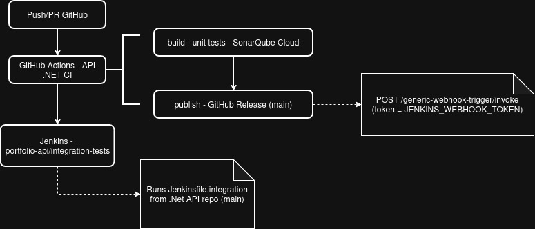

# Jenkins — Portfolio Infra

Jenkins configuration and structure to run pipelines from my **Portfolio** project. It is configured by Code using the plugin `JCasC`, there are declarative jobs (`DSL - Domain-Specific Language`) and an agent to build and run **Terraform repositories**.

TODO: list repositories here

---

## Overview

- **Controller**: image based on `jenkins/jenkins:lts` (Docker), with the wizard setup disabled and configured via **JCasC**.
- **Configuration**:
  - `casc/` — global configuration for controller (views, credentials, security).
  - `jobs.yml` — declarative jobs created via **Job DSL**.
- **Terraform Agent**: image `portfolio-terraform-agent:latest`, used by the pipelines.
- **Persistence**: volume `jenkins_home` + cache NuGet shared with my [.NetAPI](https://github.com/yagohp/portfolio-dotnet-api).
- **Docker Access**: via `docker.sock` (builds and execution inside  containers for Jenkins).
- **AWS Credentials**: the AWS profiles used by this project are configured in `~/.aws` (read-only) + secrets injected by `.env`.

---

## How to run

### Prerequisites

- Docker and Docker Compose installed.
- External networks (created by `Makefile` in this repo):

```bash
docker network create registry-net
docker network create portfolio-network
```

- File `.env` at the root directory for this repository with the environment variables set, they will be used by `casc/jenkins.yml` and `jobs.yml`, to inject in containers:

- Credentials for AWS in `~/.aws` (profiles `dev`, `staging`, `prod`).

### Running the Controller

This command is an option to run jenkins, but you also can use the `Makefile` of this project, to run dependencies as well.

```bash
docker compose -f docker-compose-jenkins.yml up -d jenkins
```

You can access the jenkins panel at `http://localhost:8080`. Login with `admin` and the password set in `JENKINS_ADMIN_PASSWORD`.

### Terraform Agent Build (optional)

```bash
docker compose -f docker-compose-jenkins.yml --profile build-only build terraform-agent
```

---

## Repository structure

```text
.
├── docker-compose-jenkins.yml   # controller + Terraform agent
├── Dockerfile                   # controller image
├── .env                         # secrets and configuration
├── casc/
│   └── jenkins.yml              # JCasC: views, credentials, security
├── jobs.yml                     # Job DSL: job creation
├── agents/
│   └── terraform/
│       └── Dockerfile           # Terraform agent image
└── jobs/
    └── repo.Jenkinsfile         # pipelines (referenced by the jobs)
```

---

## ⚙️ JCasC Configuration

The file `casc/jenkins.yml` is loaded automatically.

### Controller

| Config       | Value               |
|--------------|---------------------|
| Executors    | 4                   |
| Mode         | `NORMAL`            |
| Setup wizard | Disabled            |
| Timezone     | `America/Sao_Paulo` |
| Heap         | `-Xmx2g -Xms512m`   |

### Security

- **Realm**: local, signup disabled.
- **User**: `admin` (password set in `JENKINS_ADMIN_PASSWORD`).
- **Authorization**: logged users can do anything, anonymous reading is blocked.
- **CSRF**: `crumbIssuer` default.

### Views

| View | Filtro | Conteúdo |
|---|---|---|
| **Terraform** | `Terraform — (DEV\|STAGING\|PROD)\|terraform-.*` | Pipelines for Terraform infra |
| **Portfolio API** | `portfolio-.*` | Pipelines for .NET app |

### Registered Credentials

| ID | Tipo | Uso |
|---|---|---|
| `github-ssh-key` | SSH private key | To clone GitHub repos |
| `jenkins-webhook-token` | String | Authentication for webhooks |

> `<env>` = `dev` \| `staging` \| `prod`.

---

## Declarative Jobs - DSL

The jobs are generated by `jobs.yml` when the controller is initialized.

### Structure

```text
Terraform/
├── terraform-dev/
│   ├── bootstrap
│   ├── iam
│   ├── api
│   └── dynamodb-auth
├── terraform-staging/ (same)
└── terraform-prod/    (same)

portfolio-api/
├── integration-tests
├── deployment-dev
├── deployment-staging
└── deployment-prod
```

### Jobs Terraform

- **Folder**: `terraform-<env>`
- **Parameters**:
  - `ACTION` — `plan` \| `apply` \| `destroy`
  - `RUN_TESTS` — boolean (runs `terraform test`)
- **SCM**: `portfolio-infra`, branch `main`
- **Script**: `jobs/repo.Jenkinsfile`
- **Manual Approval**: required in `prod` for `apply`/`destroy`

### Job API — `portfolio-api/integration-tests`

- **Trigger**: webhook from GitHub Actions (`generic-webhook-trigger`), authenticated by `jenkins-webhook-token`.
- **Received variables**: `REPO`, `GIT_SHA`, `GIT_REF_NAME`, `RUN_URL`, `VERSION`.
- **Manual parameters**: `REPO_OVERRIDE`, `REF_OVERRIDE` (for executions  outside the webhook).
- **SCM**: `portfolio-dotnet-api`, branch `main`
- **Script**: `Jenkinsfile.integration`
- **Retention**: 30 builds / 10 artifacts

---

## GitHub Actions Integration



---

## Credentials

- **AWS**: AWS client will try to get the credentials informed by `AWS_PROFILE=<env>`; the profiles are stored in `~/.aws/credentials` (read-only in the controller).
- **Prod**: `apply` and `destroy` stages in Terraform pipelines requires manual approval.

---

## Helpers


### Apply changes in `casc/` and `jobs.yml`

Jenkins reload JCasC automatically when its changed, but if something happen and did not update, try to run:

```bash
docker compose -f docker-compose-jenkins.yml restart jenkins
```

### How to Validate Jenkins changes

```bash
docker exec jenkins-controller \
  java -jar /var/jenkins_home/war/WEB-INF/lib/jenkins-core-*.jar \
  --help 2>/dev/null || true
# (o comando exato depende da versão; em geral, JCasC loga erros no startup)
```

---

## Troubleshooting

| Symptom | Likely cause | Fix |
|---|---|---|
| Container starts and then exits | `.env` missing or a variable is missing | Check `env_file: .env` and the variables used in `casc/jenkins.yml` |
| `permission denied` on `~/.aws` | Host AWS profile not readable by the container user | Adjust permissions on `~/.aws` |
| `docker: permission denied` during builds | `docker.sock` without permission | The controller runs as `root`; check the host |
| Job DSL does not create jobs | Error in `jobs.yml` | Check the controller log on startup (`docker logs jenkins-controller`) |
| Webhook returns 403 | `JENKINS_WEBHOOK_TOKEN` mismatch | Align the GitHub secret with the value in `.env` |
| `AWS_PROFILE not found` | Profile does not exist in `~/.aws/credentials` | Create the `dev`/`staging`/`prod` profile on the host |
| Terraform fails on `Init` | S3 backend unreachable | Check the `portfolio-tfstate-<env>` bucket and credentials |
